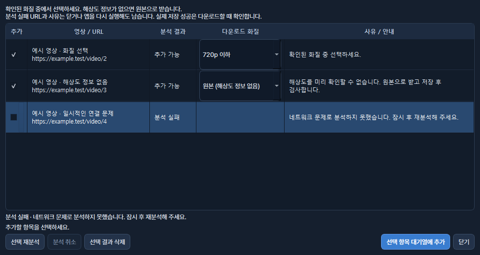

# 영상 다운로드 · VideoDownloader

Windows 64비트용 무료 영상 다운로드 앱입니다. 여러 영상 링크를 대기열에 모아 차례로 저장할 수 있습니다.

**[⬇ v0.1.9 Windows 무설치 ZIP 다운로드](https://github.com/Mackeabit/VideoDownloaderApp-releases/releases/download/v0.1.9/VideoDownloader-0.1.9-win-x64.zip)**

[사용 안내](docs/USER_GUIDE.md) · [문제 해결](docs/SUPPORT.md) · [문제 제보](https://github.com/Mackeabit/VideoDownloaderApp-releases/issues/new/choose) · [변경사항](docs/PUBLIC_RELEASE.md)

## 시작하기

1. 위의 ZIP 파일을 내려받아 **전체 압축을 풉니다**.
2. `VideoDownloader.exe`를 실행합니다. 옆의 `_internal` 폴더도 함께 보관하세요.
3. 영상 링크를 한 줄씩 입력하고 저장 폴더를 선택합니다.
4. **대기열에 추가**를 눌러 URL 분석과 영상별 화질 선택을 마친 뒤 **다운로드 시작**을 누릅니다.

별도 설치나 관리자 권한이 필요하지 않습니다. Python·Node·FFmpeg도 앱에 포함되어 있습니다.

## 주요 기능

- URL 사전 분석, 영상별 화질 선택과 실패 URL 재분석
- 여러 링크의 순차 다운로드와 대기열 저장
- 진행률 확인, 취소·재시도·지원되는 부분 파일 이어받기
- 실패 원인 안내, 링크 재분석, 진단 보고서 미리보기·저장
- 업데이트 확인과 새 버전 다운로드 페이지 연결

## 업데이트

앱의 **업데이트 확인**을 누르거나 [최신 릴리스](https://github.com/Mackeabit/VideoDownloaderApp-releases/releases/latest)를 확인하세요. 앱을 닫고 새 ZIP을 별도 폴더에 풀어 실행하면 기존 대기열과 설정을 계속 사용할 수 있습니다. 영상은 선택한 저장 폴더에 보존됩니다.

## 지원 범위

공개된 단일 영상을 대상으로 합니다. 로그인·쿠키 가져오기·DRM·실시간 방송·재생목록은 지원하지 않습니다. 사이트 변경이나 접근 제한에 따라 다운로드가 실패할 수 있습니다. 본인이 다운로드할 권한이 있는 콘텐츠에 사용하세요.

Windows x64용이며 실행 파일의 전자서명은 포함되어 있지 않습니다. 파일 확인용 체크섬은 릴리스의 `SHA256SUMS.txt`에서 제공합니다.

## 개인정보와 이용 조건

진단 보고서는 미리 확인한 후 직접 공유하며 자동 전송하지 않습니다. 자세한 내용은 [개인정보 안내](docs/PRIVACY.md)를 참고하세요.

[앱 이용 조건](LICENSE) · [외부 구성요소 고지](docs/THIRD_PARTY_NOTICES.md) · [라이선스·소스 제공 안내](docs/LICENSING.md)

일반 사용자는 **실행 ZIP 하나만** 받으면 됩니다. 외부 구성요소 소스 자료와 GitHub의 자동 생성 `Source code` 압축 파일은 앱 실행에 필요하지 않습니다.
